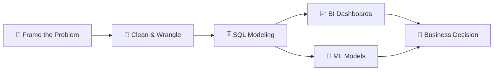

<div align="center">


<a href="https://github.com/RafiwS">
  
</a>

<br/><br/>

<a href="https://linkedin.com/in/anandawidialrafi"></a>
<a href="mailto:rafiwsbusiness@gmail.com"></a>
<a href="https://www.its.ac.id/it/"></a>


</div>

<br/>

## 🖥️ `whoami`

```bash
$ whoami
> ananda_widi_alrafi

$ cat profile.json
{
  "role"       : "Information Technology Undergraduate",
  "university" : "Institut Teknologi Sepuluh Nopember (ITS)",
  "faculty"    : "FTEIC · Dept. of Information Technology",
  "location"   : "Surabaya, Indonesia 🇮🇩",
  "focus"      : ["Data Analytics", "Business Intelligence", "Applied ML/AI"],
  "mission"    : "Build end-to-end pipelines that turn data into decisions",
  "status"     : "Open to internships & collaborations 🟢"
}
```

<br/>

## ⚡ Tech Arsenal

<div align="center">

**Languages & Databases**


**BI, Analytics & Spreadsheets**


**AI / ML & Notebooks**


</div>

<br/>

## 🧭 Data Pipeline I Run



<details>
<summary><b>🔬 Full methodology breakdown (click to expand)</b></summary>

<br/>

| Phase | What I Do | Tools |
| :--- | :--- | :--- |
| **01 · Framing** | CRISP-DM, 5 Whys, KPI hierarchies, data dictionaries | Structured problem statements |
| **02 · Spreadsheets** | Cleaning, imputation, pivots, automated trackers | Excel, Google Sheets (`XLOOKUP`, `INDEX/MATCH`) |
| **03 · SQL** | Joins, CTEs, subqueries, normalized schemas | PostgreSQL, MySQL, BigQuery |
| **04 · Window Analytics** | Cohorts, RFM, rolling metrics, anomaly queries | `OVER`, `PARTITION BY`, `LAG/LEAD`, `RANK` |
| **05 · BI** | Star schema, DAX, drill-downs, parameters | Power BI, Tableau, Looker Studio |
| **06 · AI / ML** | Feature engineering, regression, classification, clustering | Pandas, NumPy, Scikit-Learn, Colab |
| **07 · Storytelling** | Minto Pyramid, BLUF, actionable recommendations | Executive briefings & case studies |

</details>

<br/>

## 📊 GitHub Stats

<div align="center">


</div>

<br/>

## 🏆 Featured Projects

> 📌 *Pin your best repos here. Suggested format below.*

| Project | Stack | Impact |
| :--- | :--- | :--- |
| 📊 **Executive Sales Dashboard** | Power BI · DAX · SQL | *Add a metric, e.g. "cut reporting time by 60%"* |
| 🤖 **Customer Churn Predictor** | Python · Scikit-Learn | *Add accuracy / F1 score* |
| 🗄️ **Cohort Retention Analysis** | PostgreSQL · Window Functions | *Add key insight* |

<br/>

## 🤝 Let's Build Something

<div align="center">

**Open to data analytics internships, BI projects, and ML collaborations.**

<a href="mailto:rafiwsbusiness@gmail.com"></a>


</div>
